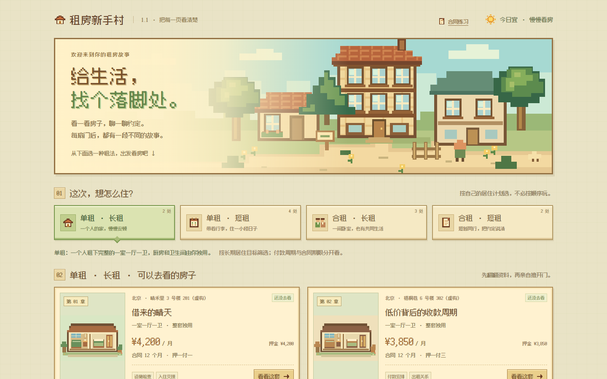
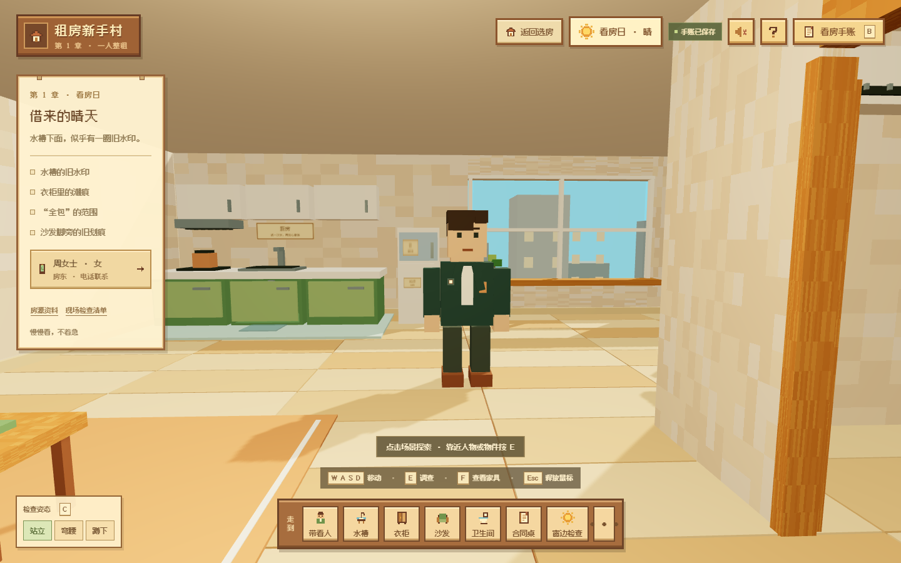
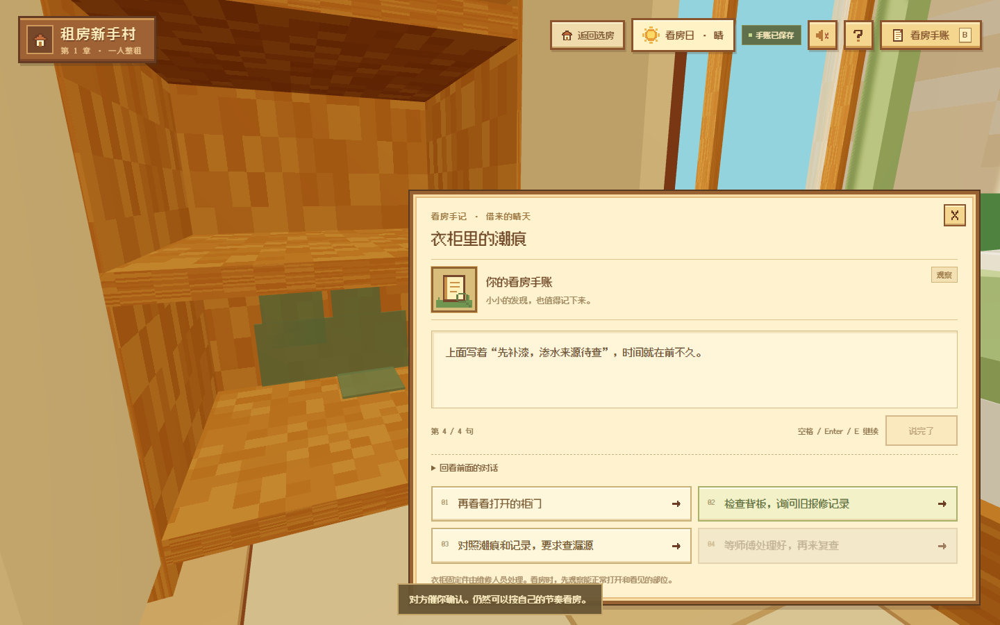

# 租房新手村

**四种租法的看房手记 · v1.1.0 · Aileen**

一款在电脑浏览器中游玩的单人租房调查游戏。选择一套房，走进第一人称 3D 方块房屋，查看现场、阅读材料、向房东、中介和室友追问，再决定是否签约。入住后的时间变化，会让看房时的选择产生不同后果。

项目使用原生 JavaScript、Three.js 和 Vite，结合像素风界面与可探索的 3D 场景。

**下载发布版：[v1.1.0](https://github.com/Aileen3568503652/rental-novice/releases/tag/v1.1.0)**。选择 `rental-novice-v1.1.0-web.zip` 可获得已构建的网页文件；解压后需通过静态网页服务访问。下载源码后开发和运行的方法见下文。

## 游戏画面

### 主界面与房源选择

选择单租或合租、长租或短租，查看每套房的目标、合同期限和费用。



### 第一人称看房

进入房屋，在客厅、卧室、厨房和卫生间之间移动，靠近人物与物件进行互动。



### 现场检查与材料核对

观察痕迹、追问原因、要求处理，再回来复查。听到承诺与确认完成，会留下不同的调查记录。



### 独立合同练习

《签字前的最后一页》提供 14 条合同和 6 份材料，练习标记、对照、协商、确认与签署。


## 可以体验什么

- **四种租法、9 个主关卡和 2 套可进入的备选房**：每套房有各自的租期、报价、角色与剧情。“单租”指一人整租一室一厅一卫，合租只承租其中一间卧室。
- **现场调查**：检查渗漏、潮湿、设施和交接痕迹；打开柜门、蹲下查看低处，或移动轻便家具。
- **多人求证**：与房东、中介、室友及陪看介绍人交谈，对照说法与材料。对白按句显示，可点击或按键继续，也可回看前文。
- **选择与后果**：签约、暂缓或放弃；模拟入住后回看不同时间点的变化。拒绝签约不会自动判为失败。
- **独立合同练习与六城参考册**：合同练习有自己的房源和存档；参考册展示带日期的历史样本与交通入口。

| 租法 | 主关卡 |
| --- | --- |
| 单租长租 | 借来的晴天；低价背后的收款周期 |
| 单租短租 | 只住三个月，却要签一年；只剩四十五天的转租 |
| 合租长租 | 隔壁的第四双鞋；谁用了这度电；借来的那把钥匙 |
| 合租短租 | 转租剩下的两个月；三个月与六个月 |

可以先在《借来的晴天》中体验两次看房：一次直接作出决定，一次仔细核对现场与材料，再比较入住后的不同反馈。

## 本地运行

需要支持 WebGL 的现代桌面浏览器，以及 **Node.js 22.12 或更高版本**。项目所用 Vite 的兼容范围为 `^20.19.0 || >=22.12.0`。

```sh
git clone https://github.com/Aileen3568503652/rental-novice.git
cd rental-novice
npm ci
npm run dev
```

打开终端显示的本地网址，游玩期间保持服务运行。在终端按 `Ctrl + C` 可停止服务。

**不要直接双击 `index.html`。** 游戏需要通过网页服务加载脚本、样式和资源；直接以本地文件方式打开无法正常启动。

### 基本操作

| 操作 | 功能 |
| --- | --- |
| W、A、S、D 或方向键 | 移动 |
| 点击场景后移动鼠标 | 转动视角；未锁定鼠标时可按住拖动 |
| E | 与近处人物或物件互动 |
| F | 移动轻便物品，或检查大型家具 |
| C | 蹲下／站起 |
| B | 查看调查笔记 |
| Esc | 释放鼠标或关闭面板 |
| 点击对白／空格／Enter／E | 补全当前句或继续下一句 |

游戏提供场景快捷导航、姿态按钮、按键调整和减少动态效果选项。音效默认关闭。

## 构建发布文件

```sh
npm run build
npm run preview
```

`build` 将可部署的网页文件生成到 `dist/`；`preview` 用于在本机检查这份构建结果，访问地址以终端输出为准。部署时应上传 **`dist/` 中的全部内容**，包括脚本、样式、字体和素材，不能只上传 `index.html`。构建产物同样需要通过网页服务访问。

## 项目结构

```text
src/                  游戏源码
  main.js             入口
  app.js              流程、互动与场景切换
  world.js            3D 房屋、人物、设施与移动
  cases.js            房源与关卡配置
  campaign.js         剧情规则、证据与后果
  inspections.js      补充检查与材料核对
  contract-practice.js 独立合同练习规则
  storage.js          本地存档
  style.css           像素风界面样式
public/               字体、插画与图标
docs/screenshots/     四张实际游戏截图
tests/                游戏规则与存档等自动化测试
index.html            网页入口
package.json          依赖与运行命令
```

`node_modules/` 是本地安装的依赖，`dist/` 是生成的构建目录。修改游戏请编辑 `src/` 和 `public/`，然后重新构建。

## 检查

```sh
npm test
```

测试覆盖剧情前置条件、关卡后果、合同练习、角色、检查和存档等逻辑。修改 3D 场景后，还需要在浏览器中检查移动、碰撞、遮挡和画面表现。

## 存档与内容范围

每套房的进度、轻便物品位置及操作偏好保存在当前浏览器的 `localStorage` 中；合同练习使用独立存档。切换浏览器、设备或网站地址，或清除网站数据，可能会看不到原来的进度。项目没有账号系统、游戏后端或云端同步。

游戏使用固定选项对话，场景、人物、金额和材料均为虚构改编。路线卡是静态示意，六城参考册中的历史样本未重新核验；它们不代表实时房源、当前报价或现行政策。游戏中的协商结果与剧情反馈不能替代真实合同和具体事项的核实。

## 字体与素材

房屋插画、像素图标、人物头像及 3D 场景由项目自行绘制或构建。中文字体使用 TakWolf 的 Fusion Pixel Font（缝合像素字体），随项目保留 SIL Open Font License 1.1 与上游字体许可。

完整来源、字体版本与文件校验信息见 [第三方素材说明](THIRD_PARTY_NOTICES.md)，字体许可位于 [public/fonts/OFL.txt](public/fonts/OFL.txt)。第三方许可不自动适用于本项目的其他代码或素材。

---

作者：[Aileen](https://github.com/Aileen3568503652) · 仓库：[rental-novice](https://github.com/Aileen3568503652/rental-novice)
